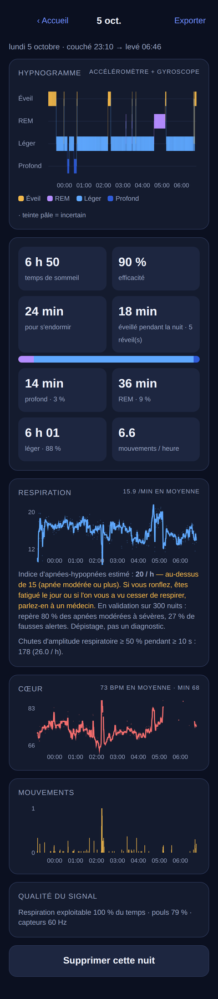

# ☾ Somno — suivre son sommeil avec un seul iPhone

Système DIY de suivi du sommeil qui n'utilise **que l'iPhone 14 Pro**, sans montre, bague
ni capteur de lit :

- **respiration** (rythme, régularité, pauses) : l'iPhone posé sur le matelas sent le
  matelas s'incliner à chaque inspiration (gyroscope + accéléromètre) ;
- **battements cardiaques** par **ballistocardiographie** : la petite secousse du corps à
  chaque battement, transmise par le matelas ;
- **mouvements** et retournements ;
- **sons** : ronflements, et extraits des bruits marquants à réécouter ;
- **sonar ultrasonore** (option) : respiration sans contact, iPhone sur la table de nuit ;
- **stades de sommeil** (éveil / léger / profond / REM) estimés par un modèle entraîné sur
  **300 nuits de polysomnographie réelles** ;
- **indice d'événements respiratoires** (dépistage d'apnées, indicatif).

Tout est calculé **sur l'iPhone** ; aucune donnée n'est envoyée.

👉 L'exploration complète, avec tous les capteurs, les méthodes, les résultats chiffrés et
les limites, est dans **[docs/EXPLORATION.md](docs/EXPLORATION.md)**.

## Résultats en bref

Validation sur de vraies nuits de polysomnographie (PhysioNet/CinC 2018). Les signaux
« iPhone sur le matelas » sont simulés à partir des ceintures et de l'ECG de chaque nuit.

| Mesure | Résultat |
|---|---|
| Éveil / sommeil, époques de 30 s | **86 %** (κ 0,51), validation croisée sur 300 nuits |
| 4 stades (éveil, léger, profond, REM) | **66 %** (κ 0,41) ; 12 nuits jamais vues : 67 % (κ 0,45) |
| Borne haute avec signaux PSG parfaits | 70 % (κ 0,50) |
| Fréquence respiratoire (matelas incliné ≥ 0,1°) | **±0,6 resp/min** |
| Fréquence cardiaque (secousse ≥ 1 mg, iPhone près du thorax) | **±1,2 bpm** |
| Sonar à 0,5–1 m, sans couette : respiration · pouls | 86–88 % à ±1 resp/min · 64–86 % à ±3 bpm |
| Dépistage d'apnée modérée (IAH ≥ 15) | AUC **0,86**, sensibilité 80 %, spécificité 73 % |



## Démarrage rapide (application web, rien à installer)

1. Publiez le dossier `sommeil/web/` en HTTPS. Le plus simple : **GitHub Pages** sur ce dépôt
   (Réglages › Pages › branche `main`, dossier `/`). L'app sera alors à
   `https://<utilisateur>.github.io/<dépôt>/sommeil/web/`.
   En local : `cd sommeil/web && python3 -m http.server`. Safari exige HTTPS pour les
   capteurs, donc pour un iPhone sur le Wi-Fi, passez par un tunnel HTTPS ou par Pages.
2. Sur l'iPhone, ouvrez l'adresse dans **Safari**. Ajoutez-la à l'écran d'accueil si vous voulez.
3. **Préparer la nuit** › **Tester le placement** : allongez-vous avec l'iPhone en place.
   La vérification affiche votre respiration et votre pouls en direct ; déplacez l'iPhone
   jusqu'à obtenir ✓ pour les deux.
4. Le soir : chargeur branché, *Ne pas déranger*, luminosité au minimum,
   **Démarrer l'enregistrement**. L'écran reste noir, avec une horloge très sombre.
5. Le matin : touchez l'écran, **maintenez** le bouton pour terminer, et lisez le rapport.

Placement conseillé : **à plat sur le matelas, sous le drap-housse (ou sous l'oreiller), au
niveau de la poitrine, à 10–30 cm du corps**. Plus l'iPhone est près du thorax, mieux on
capte le pouls.

## Application iOS native (optionnelle)

Elle permet l'écran éteint, des capteurs à 100 Hz, un sonar fiable, la caméra de profondeur
TrueDepth et l'écriture dans **Apple Santé**. Voir [ios/README.md](ios/README.md). Il faut un
Mac avec Xcode ; un compte Apple gratuit suffit.

## Analyse sur ordinateur

```bash
cd sommeil/analysis
pip install numpy scipy scikit-learn matplotlib
python -m somno.cli ma-nuit.somno --out ma-nuit.png --csv ma-nuit.csv
```

Le fichier `.somno` s'obtient avec Rapport › Exporter › Données brutes (app web) ou le bouton
de partage (app iOS).

## Reproduire la validation

```bash
cd sommeil/analysis
pip install numpy scipy scikit-learn matplotlib h5py wfdb torch pytest
python datasets/fetch_challenge2018.py --n 300        # ≈ 40 Go téléchargés, 4 Go conservés
python experiments/e03_build_features.py               # caractéristiques iPhone simulées + PSG
python experiments/e05_staging.py                      # validation croisée + modèle → web/model/
python experiments/e01_mattress_snr.py                 # précision respiration/pouls vs couplage
python experiments/e02_sonar.py                        # sonar vs distance
python experiments/e04_apnea.py                        # dépistage d'apnées
python experiments/e06_hrv_gain.py                     # la VFC battement par battement aide-t-elle ?
python experiments/e07_holdout.py                      # test final sur des nuits jamais vues
python experiments/make_figures.py                     # → docs/figures/
python experiments/build_report.py                     # → docs/rapport.html + résultats de EXPLORATION.md
python -m pytest tests -q                              # parité Python ⇄ JS ⇄ JavaScriptCore
node web/tests/e2e.mjs                                 # test de bout en bout dans Chromium (Playwright)
```

## Avertissement

Projet personnel et expérimental, **pas un dispositif médical**. Les stades sont des
estimations. Si vous ronflez fort, si vous faites des pauses respiratoires ou si vous êtes
somnolent le jour, consultez un médecin : seule une polygraphie ou une polysomnographie
peut diagnostiquer une apnée du sommeil.
