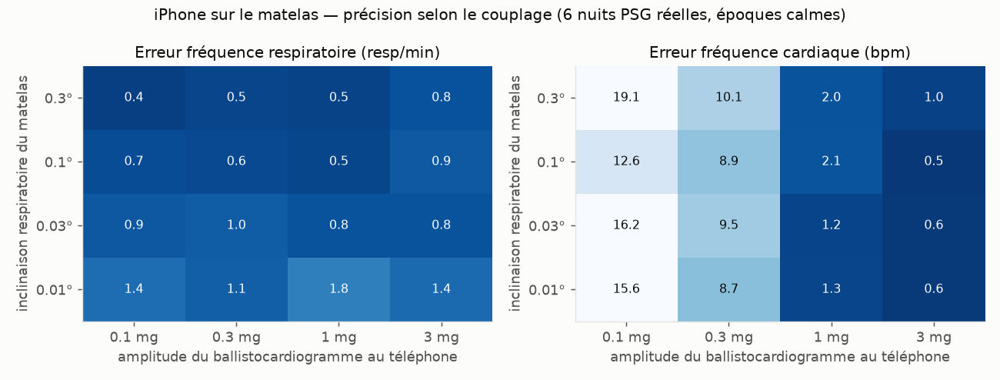
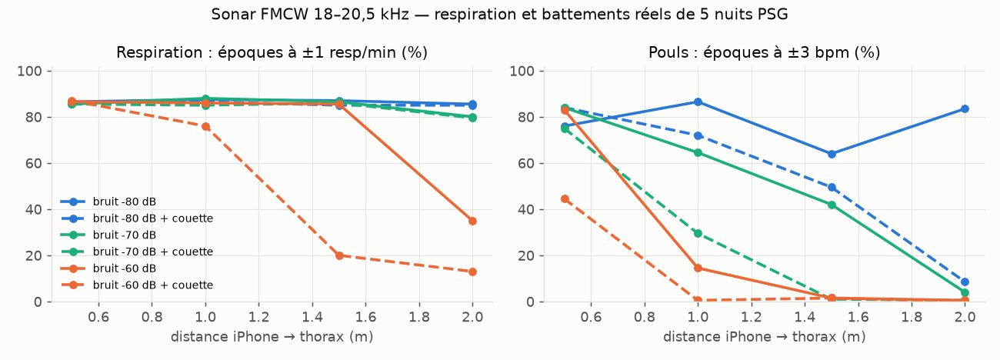
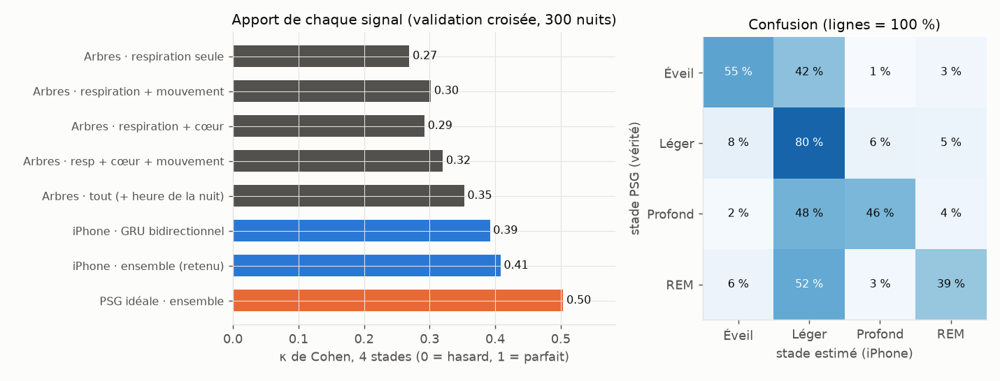
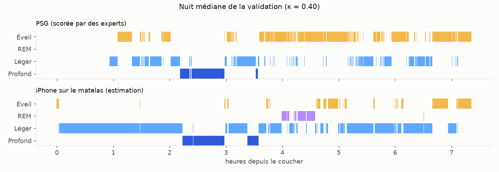
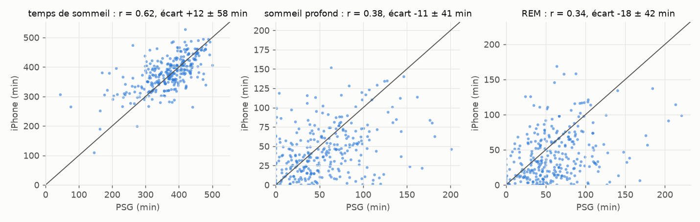
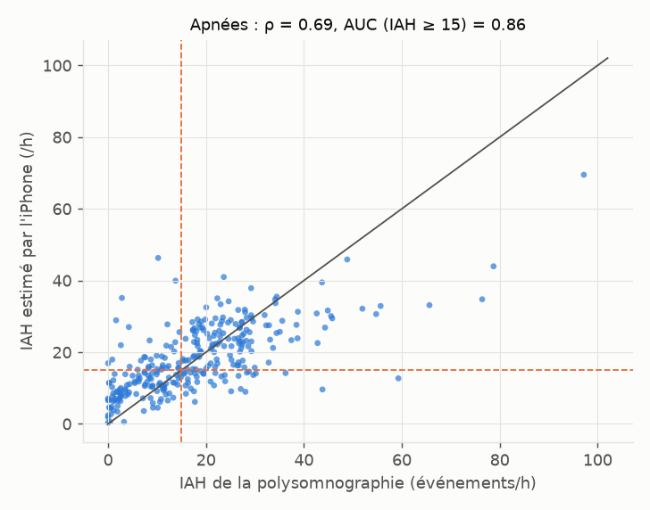

# Suivre son sommeil avec un seul iPhone 14 Pro — exploration complète

Objectif : un système DIY de suivi du sommeil **le plus précis possible**, avec pour seul
matériel un iPhone 14 Pro (pas de montre, pas de bague, pas de capteur sous le matelas).

Ce document passe en revue **tous les capteurs de l'iPhone**, ce que chacun peut mesurer la
nuit, comment y accéder (page web Safari ou application native), et ce que les expériences
menées ici montrent. Les chiffres viennent de `analysis/results/` ; la méthode de chaque
expérience est en tête de son script dans `analysis/experiments/`.

---

## 1. Ce qu'on peut espérer mesurer

Le sommeil se « voit » vraiment dans l'activité cérébrale (EEG) : c'est la référence, la
polysomnographie (PSG). Aucun appareil grand public n'a d'EEG. Montres, bagues et capteurs de
lit **estiment** les stades à partir de signaux indirects qui changent avec eux :

| Signal | Éveil | Sommeil léger (N1-N2) | Profond (N3) | Paradoxal (REM) |
|---|---|---|---|---|
| Mouvements | fréquents | rares | quasi nuls | nuls (atonie), petits sursauts |
| Respiration | irrégulière | assez régulière | **très régulière**, lente | **irrégulière**, plus rapide |
| Fréquence cardiaque | haute, variable | moyenne | **basse, stable** | plus haute, variable |
| Moment de la nuit | début, fin | partout | **surtout en début** | **surtout en fin** |

Les meilleurs systèmes sans EEG (montres avec PPG, capteurs de lit, radar) atteignent dans
les études un **κ de Cohen ≈ 0,4–0,65** sur 4 stades et **≈ 85–95 %** d'accord
veille/sommeil. Le κ mesure l'accord au-delà du hasard : 0 pour le hasard, 1 pour un accord
parfait ; deux scoreurs humains de PSG se situent vers 0,75–0,8.
Les performances baissent chez les personnes qui ont des troubles du sommeil (apnées,
insomnie), comme dans les données de validation utilisées ici.

**Ce qui peut être très précis avec un iPhone :** l'heure d'endormissement et de réveil, la
durée de sommeil, la fréquence respiratoire (au dixième de respiration par minute), la
fréquence cardiaque si le couplage au matelas est bon, les mouvements, les ronflements et les
pauses respiratoires. **Ce qui reste une estimation :** la répartition fine léger / profond / REM.

## 2. Inventaire des capteurs de l'iPhone 14 Pro

| Capteur | Mesure possible la nuit | Web (Safari) | App native | Verdict |
|---|---|---|---|---|
| **Accéléromètre** | inclinaison du matelas à chaque respiration (gravité projetée, 1–9 mg) ; vibration cardiaque (BCG) ; mouvements | `devicemotion` ~60 Hz | CoreMotion 100 Hz | ★★★ **cœur du système** |
| **Gyroscope** | vitesse d'inclinaison → angle (meilleur rapport signal/bruit que l'accéléromètre pour la respiration) ; BCG rotationnel | `rotationRate` | 100 Hz | ★★★ |
| **Micro** (3 micros) | ronflements, toux, paroles, bruit ambiant ; réception du sonar | `getUserMedia` | AVAudioEngine | ★★ sons ; ★★★ avec sonar |
| **Haut-parleurs** | émission de chirps ultrasonores 18–20,5 kHz (sonar FMCW) | Web Audio (expérimental) | ★★★ fiable | ★★★ respiration **sans contact** |
| **Caméra TrueDepth** (IR) | carte de profondeur dans le noir → mouvement du thorax | ✗ | AVCaptureDepthDataOutput | ★★ expérimental (écran allumé) |
| **LiDAR** (arrière) | idem, portée plus longue | ✗ | ARKit / AVFoundation | ★ a besoin de lumière pour ARKit ; TrueDepth suffit |
| Caméra couleur | rien dans le noir ; **mesure du pouls au doigt le matin** (PPG) | possible | ✓ | ★ complément (VFC au réveil) |
| Capteur de lumière ambiante | lumière de la chambre | ✗ (pas d'API) | ✗ (SensorKit = recherche) | ✗ |
| Baromètre, magnétomètre, GPS | sans intérêt pour le sommeil | | | ✗ |
| Usage du téléphone | heure de coucher (dernier déverrouillage) | ✗ | Temps d'écran : pas d'API | ✗ |
| Wi-Fi / Bluetooth / UWB (détection radio) | possible en recherche (CSI Wi-Fi) | ✗ | ✗ (pas d'accès aux données radio brutes) | ✗ |
| Apple Santé | écrire les stades estimés | ✗ | HealthKit | ✓ intégration |

### Trois façons de poser l'iPhone

1. **Sur le matelas** (recommandé) : à plat, sous le drap-housse ou sous l'oreiller, au niveau
   de la poitrine. Respiration + pouls + mouvements par contact mécanique.
2. **Sur la table de nuit, sonar** : haut-parleur et micro tournés vers la personne, à moins
   d'1 m. Respiration + mouvements (+ pouls à courte distance) sans contact. Principe
   d'ApneaApp (Univ. Washington, 2015) et de SleepScore.
3. **Sur un support, caméra TrueDepth** : la profondeur du thorax, dans le noir complet
   (projecteur infrarouge). Expérimental, uniquement dans l'app native, écran allumé.

## 3. Ce qui a été construit

```
sommeil/
├── web/          application web (Safari) : enregistrement, analyse, rapport — aucune installation
├── ios/          application native SwiftUI : écran éteint, 100 Hz, sonar fiable, TrueDepth, Apple Santé
├── analysis/     bibliothèque Python « somno » + expériences + tests
│   ├── somno/    dsp, respiration, cœur (BCG), mouvements, sonar, apnées, stades, simulateur
│   ├── experiments/ e01…e05 + figures
│   └── tests/    parité Python ⇄ JavaScript ⇄ script JavaScriptCore
└── docs/         ce document, figures
```

**Une seule implémentation de référence, vérifiée trois fois.** Les algorithmes sont écrits en
Python, validés sur de vraies nuits, puis portés en JavaScript. Les tests comparent les sorties
nombre par nombre : écart relatif maximal ~1e-5, dû à l'arrondi des FFT. Les tests couvrent
toutes les caractéristiques, le modèle de stades (arbres et GRU), l'AudioWorklet du sonar et
le script exécuté par l'app iOS.

### Chaîne de traitement

1. **Ré-échantillonnage** des événements `devicemotion` (≈ 60 Hz irréguliers) sur une grille de 50 Hz.
2. **Respiration** : le gyroscope intégré donne l'angle du matelas ; il est combiné aux trois
   axes de l'accéléromètre (passe-bande 0,08–1 Hz, ramené à 10 Hz). Chaque canal est
   **blanchi**, c'est-à-dire divisé par son niveau de bruit. Une **ACP robuste**, qui ignore
   les secondes agitées, extrait alors l'onde respiratoire. Les respirations sont détectées
   par passages par zéro avec hystérésis. Sur 60 s, on calcule le rythme, la variabilité des
   intervalles et des amplitudes, la régularité (autocorrélation) et la netteté spectrale.
3. **Cœur (BCG)** : bande 4–12 Hz sur les six canaux, enveloppe d'énergie, puis
   autocorrélation sur 10 s toutes les 5 s, pondérée par la qualité de chaque canal. Un
   **suivi de Viterbi** de la période cardiaque sur toute la nuit évite les sauts d'octave.
4. **Mouvements** : énergie au-dessus de 1 Hz par seconde, rapportée au niveau de repos de la
   nuit. Cela donne, pour chaque époque, la fraction de temps agité, l'intensité, et le temps
   écoulé depuis le dernier mouvement et jusqu'au suivant.
5. **Stades** : 80 caractéristiques par époque de 30 s. Elles sont aussi exprimées par
   rapport à la nuit (z-score robuste), avec un contexte glissant de 2,5, 5,5 et 10,5 min.
   Deux modèles les exploitent : des **arbres boostés** et un **GRU bidirectionnel** qui voit
   toute la nuit. On fait la **moyenne** des deux.
6. **Apnées** : l'enveloppe de l'onde respiratoire sert à repérer les chutes d'au moins 50 %
   pendant 10 à 120 s, hors mouvements. On en tire un indice d'événements par heure de sommeil.
7. **Sons** : 4 fois par seconde, le niveau sonore et 6 bandes de fréquence. Un ronflement
   se repère à des bouffées de 150–1000 Hz répétées au rythme respiratoire. Les bruits
   marquants (+15 dB) déclenchent un extrait de 10 s.
8. **Sonar** : chirps de 1024 échantillons, corrélation circulaire avec le chirp émis (profil
   de distance, une case ≈ 1,4 cm) et réalignement sur le trajet direct. Pour chaque époque,
   on garde la case la plus « respiratoire » ; un ajustement de cercle dans le plan I/Q donne
   la phase, puis le déplacement en mm.

## 4. Résultats des expériences

Chiffres produits par `analysis/experiments/build_report.py` à partir de `analysis/results/`.

<!-- RESULTATS:DEBUT -->
### Expérience 1 — iPhone sur le matelas : respiration et pouls

6 nuits PSG réelles converties en signaux d'iPhone, époques calmes, erreur absolue moyenne (capteurs sans arrondi) :

| inclinaison \ secousse BCG | 0,1 mg | 0,3 mg | 1 mg | 3 mg |
|---|---|---|---|---|
| **0,01°** | 1,4 resp/min · 15,6 bpm | 1,1 resp/min · 8,7 bpm | 1,8 resp/min · 1,2 bpm | 1,4 resp/min · 0,6 bpm |
| **0,03°** | 0,9 resp/min · 16,2 bpm | 1,1 resp/min · 9,5 bpm | 0,8 resp/min · 1,2 bpm | 0,8 resp/min · 0,6 bpm |
| **0,1°** | 0,7 resp/min · 12,6 bpm | 0,6 resp/min · 8,9 bpm | 0,5 resp/min · 2,1 bpm | 0,9 resp/min · 0,5 bpm |
| **0,3°** | 0,4 resp/min · 19,1 bpm | 0,5 resp/min · 10,1 bpm | 0,5 resp/min · 2,0 bpm | 0,8 resp/min · 1,0 bpm |

Respiration : ±0,60 resp/min dès 0,1° d'inclinaison (87 % des époques à ±1). Pouls : ±1,2 bpm dès 1 mg (86 % à ±3 bpm). Avec un arrondi des capteurs à 0,1 m/s² (comme Chrome), le pouls devient faux (±18 bpm) : l'app mesure ce pas.



### Expérience 2 — sonar FMCW

| distance | micro -80 dB | micro -80 dB + couette | micro -70 dB | micro -70 dB + couette | micro -60 dB | micro -60 dB + couette |
|---|---|---|---|---|---|---|
| 0,5 m | 86 % · 76 % | 86 % · 84 % | 86 % · 84 % | 86 % · 75 % | 86 % · 83 % | 87 % · 44 % |
| 1,0 m | 88 % · 86 % | 86 % · 72 % | 88 % · 64 % | 85 % · 30 % | 86 % · 15 % | 76 % · 0 % |
| 1,5 m | 87 % · 64 % | 85 % · 49 % | 86 % · 42 % | 86 % · 1 % | 85 % · 2 % | 20 % · 2 % |
| 2,0 m | 86 % · 84 % | 85 % · 8 % | 80 % · 4 % | 80 % · 0 % | 35 % · 0 % | 13 % · 0 % |

(respiration à ±1 resp/min · pouls à ±3 bpm, en % des époques)



### Expérience 3 — stades de sommeil (300 nuits, validation croisée par nuit)

| modèle | exactitude 4 stades | κ 4 stades | κ 3 stades | veille/sommeil | κ veille/sommeil | éveil reconnu |
|---|---|---|---|---|---|---|
| iPhone · arbres boostés | 65 % | 0,35 | 0,40 | 86 % | 0,46 | 47 % |
| iPhone · GRU bidirectionnel | 61 % | 0,39 | 0,42 | 84 % | 0,48 | 59 % |
| **iPhone · ensemble (app)** | 66 % | 0,41 | 0,44 | 86 % | 0,51 | 55 % |
| PSG idéale · ensemble | 70 % | 0,50 | 0,55 | 88 % | 0,58 | 64 % |

Apport de chaque signal (arbres seuls, κ 4 stades) : respiration seule 0,27 · respiration + mouvement 0,30 · respiration + cœur 0,29 · resp + cœur + mouvement 0,32 · tout (+ heure de la nuit) 0,35.

VFC battement par battement (ECG parfait) : κ 0,434 → 0,447 ; gain négligeable, inutile de chercher chaque battement dans le BCG.

Nuit par nuit : temps de sommeil 12 ± 58 min (r = 0,62), efficacité 2,7 ± 13,0 points, profond r = 0,38, REM r = 0,34.

Selon la sévérité des apnées : IAH < 5 (n=51) κ 0,42 · IAH 5–15 (n=81) κ 0,42 · IAH 15–30 (n=133) κ 0,41 · IAH ≥ 30 (n=35) κ 0,35.







### Expérience 4 — dépistage d'apnées

Classifieur appris (probabilité qu'une époque contienne une apnée/hypopnée, moyenne sur la nuit, calibrée), validation croisée sur 300 nuits iPhone simulées : ρ = 0,69, AUC IAH ≥ 15 = 0,86, AUC IAH ≥ 30 = 0,84 ; au seuil de 15 : sensibilité 80 %, spécificité 73 % ; erreur moyenne 7,2 événements/h. Même classifieur sur signaux PSG parfaits : AUC 0,88. Le simple seuil de chute d'amplitude (≥ 40 %) n'atteignait que AUC 0,65 (ceintures PSG : 0,78).



### Expérience 7 — test final sur des nuits jamais vues

12 nuits absentes de l'apprentissage, modèle final de l'application : exactitude 4 stades 67 % (κ = 0,45), veille/sommeil 84 % (κ = 0,44). Par nuit : κ 0,42, κ 0,08, κ 0,26, κ 0,57, κ 0,45, κ 0,11, κ 0,45, κ 0,65, κ 0,46, κ 0,68, κ 0,60, κ 0,44.

<!-- RESULTATS:FIN -->

## 5. Essais, erreurs et leçons

Ce qui a été tenté en cours de route, avec ce que chaque essai a appris :

| Essai | Constat | Décision |
|---|---|---|
| ACP directe sur les 6 canaux de mouvement | les axes de l'accéléromètre, plus bruités, dominaient : 5,8 resp/min d'erreur à 0,03° d'inclinaison | **blanchiment** des canaux (÷ bruit) → 0,8 resp/min ; le gyroscope intégré porte l'essentiel |
| Fréquence cardiaque du sonar en bande 0,8–3 Hz | les harmoniques de la respiration (5 mm) écrasent le battement (0,3 mm) : 0–80 % des époques à ±3 bpm | **enveloppe d'énergie 3–10 Hz**, comme le BCG → 98–100 % |
| Lissage HMM après les arbres | les caractéristiques de contexte se recouvrent, l'HMM compte deux fois la même évidence : κ ↑ mais exactitude ↓ | **GRU bidirectionnel** sur toute la nuit, moyenné avec les arbres |
| Poids de classes « équilibrés » + division par l'a priori dans l'HMM | double correction en faveur des stades rares : exactitude 33 % | une seule correction (pondération douce du GRU) |
| VFC battement par battement (RMSSD, LF/HF…) depuis un ECG parfait | +0,01 de κ seulement | inutile de chercher chaque battement dans le BCG |
| Mouvement « PSG » à partir du bruit haute fréquence de l'ECG | ce bruit trahit le tonus musculaire (EMG), qu'un téléphone ne voit pas | écarté, pour ne pas surestimer la précision |
| Fréquence respiratoire en direct sur 40 s | la dérive de l'intégration du gyroscope faussait le pic spectral (7/min au lieu de 15) | bande resserrée 0,13–0,7 Hz pour l'affichage en direct → 15,0/min stable |
| Arrondi des capteurs « à la Chrome » (0,1 m/s²) | respiration intacte (grâce au gyroscope), pouls faux avec une qualité trompeuse | l'écran de vérification mesure et affiche le pas réel |

## 6. Limites honnêtes

- **Pas de mesure sur un vrai iPhone dans cette exploration.** L'environnement de
  développement n'avait ni iPhone ni Mac. Les algorithmes sont validés sur de **vraies nuits
  de PSG**, mais les signaux « iPhone sur le matelas » y sont **simulés** à partir des
  ceintures respiratoires et de l'ECG, avec un modèle physique du couplage au matelas. Le
  simulateur fixe les amplitudes, le bruit des capteurs et les mouvements, mais un vrai
  matelas aura ses surprises : mousse, ressorts, partenaire, position. **Première étape
  conseillée** : enregistrer quelques nuits, exporter le `.somno` et les ré-analyser
  (`python -m somno.cli`).
- **Population de validation** : patients adressés en laboratoire du sommeil (PhysioNet/CinC
  2018, beaucoup d'apnées). C'est plus difficile que des dormeurs en bonne santé : attendez-vous
  à un peu mieux chez vous.
- **Proxy de mouvement prudent** : dans les PSG, les mouvements ne sont visibles qu'à travers
  les artefacts des ceintures. Un vrai accéléromètre de lit en voit davantage, ce qui devrait
  surtout améliorer la détection de l'éveil (le point faible ici).
- **Safari** : précision des capteurs inconnue (arrondi possible) et écran allumé la nuit.
  L'écran de vérification mesure le pas de quantification réel et l'affiche.
- **Apnées** : un capteur d'effort respiratoire rate une partie des apnées obstructives (le
  thorax continue de bouger). L'indice est un **signal pour consulter**, jamais un diagnostic.

## 7. Pistes pour aller plus loin

1. **Calibrer sur vos nuits** : quelques nuits avec une référence (montre empruntée, ou mieux
   une polygraphie prescrite) permettent d'ajuster les seuils de mouvement et du BCG.
2. **Battement par battement** : avec l'app native à 100 Hz et l'iPhone sous le thorax, on peut
   viser les intervalles RR (variabilité cardiaque fine : RMSSD, LF/HF), connus pour bien
   séparer REM et sommeil profond.
3. **Fusion sonar + matelas** : les deux capteurs en même temps, case par case et époque par
   époque.
4. **Réveil intelligent natif** : dans l'app iOS, avec notifications locales.
5. **Mesure du pouls au doigt le matin** (caméra + flash) : la variabilité cardiaque au
   réveil, un bon indicateur de récupération. Le dépôt contient déjà SéismoCardio pour la
   mesure sur la poitrine.

## Références

- Walch et al., *Sleep stage prediction with raw acceleration and photoplethysmography heart rate data derived from a consumer wearable device*, Sleep 2019.
- Nandakumar, Gollakota, Watson, *Contactless sleep apnea detection on smartphones* (ApneaApp), MobiSys 2015.
- Fonseca et al., *Cardiorespiratory sleep stage detection using conditional random fields*, IEEE JBHI 2017.
- Sun et al., *Sleep staging from electrocardiography and respiration with deep learning*, Sleep 2020.
- Radha et al., *Sleep stage classification from heart-rate variability using LSTM networks*, Sci. Rep. 2019.
- Ghassemi et al., *You Snooze, You Win: the PhysioNet/Computing in Cardiology Challenge 2018*.
- Inan et al., *Ballistocardiography and seismocardiography: a review of recent advances*, IEEE JBHI 2015.
